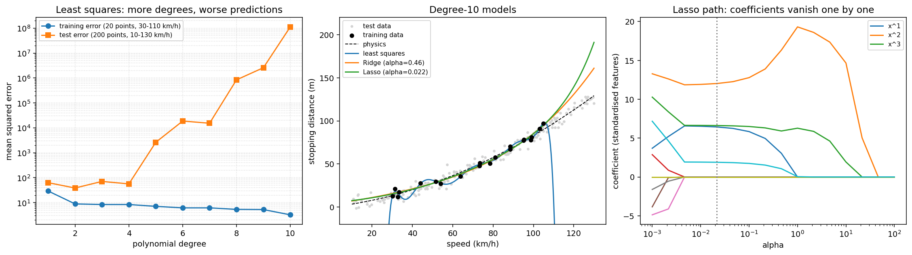
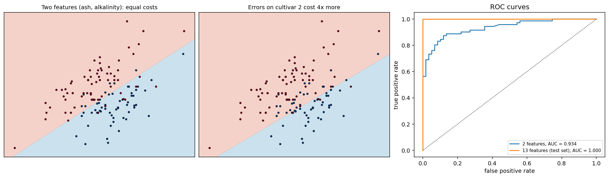
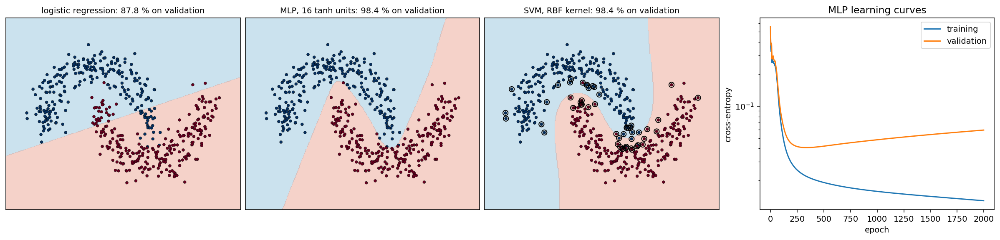
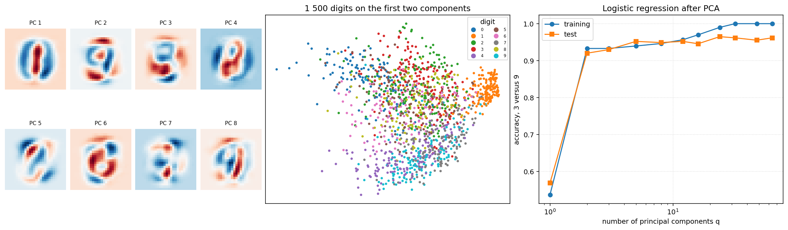
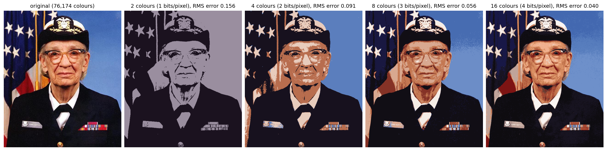

# ML from Scratch

**Eight classical machine-learning algorithms implemented with NumPy only, each one checked
against scikit-learn and used in an experiment that shows what it is for.**

I wrote this to understand what happens inside the `fit` methods I use: the optimisation
problem, the algorithm that solves it, and the numerical details that make it work.

| Module | Algorithm | How it is solved | Verified against |
|---|---|---|---|
| `linear.py` | least squares, Ridge | QR/SVD solver, closed form | `LinearRegression`, `Ridge` (same coefficients) |
| `linear.py` | Lasso | cyclic coordinate descent with soft-thresholding | `Lasso` (coefficients within 10⁻⁵) |
| `logistic.py` | logistic regression, class weights, ROC/AUC | Newton's method (IRLS) | `LogisticRegression`, `roc_auc_score` |
| `unsupervised.py` | PCA | SVD of the centred data | `PCA` (same axes and variance ratios) |
| `unsupervised.py` | k-means | Lloyd's iterations, k-means++ seeding | `KMeans` (same inertia) |
| `neural.py` | multilayer perceptron | hand-written backpropagation, momentum | finite-difference gradient check |
| `svm.py` | kernel SVM | SMO with maximal-violating-pair selection | `SVC` / libsvm (same support vectors) |

```bash
pip install -r requirements.txt
pytest                           # 13 tests, ~4 s
python experiments/run_all.py    # 5 experiments, ~25 s, rewrites figures/
```

## 1. Overfitting and regularisation

The stopping distance of a car is `v·t_r + v²/(2a)`: a degree-2 polynomial of the speed.
Twenty noisy measurements between 30 and 110 km/h are fitted with polynomials of degree 1 to 10,
then tested on speeds from 10 to 130 km/h.



* The training error keeps decreasing with the degree, while the test error explodes: the
  degree-10 least-squares fit has a test error of 10⁸ (m²). The best degree on the test set is 2,
  the true one.
* **Ridge** and **Lasso** keep the degree-10 model usable (test error 89 and 210), with the
  penalty chosen by 5-fold cross-validation on the 20 training points.
* The **Lasso path** (right) shows coefficients reaching exactly zero as the penalty grows. At the
  selected penalty only 4 of the 10 powers remain.

## 2. Logistic regression on wine chemistry

Two cultivars of the UCI Wine dataset (130 wines, 13 chemical measurements).



* With two weakly informative features (ash and its alkalinity), the classes overlap: 87.7 %
  accuracy, 8 errors on each side. Newton's method converges in 8 iterations.
* Making errors on the second cultivar four times more costly moves the boundary: missed wines
  of that cultivar drop from 8 to 4, at the price of 22 false alarms instead of 8. The ROC curve
  shows every such trade-off at once.
* With the 13 features, the test accuracy reaches 97.4 % on held-out wines.

## 3. When a straight line is not enough



On two interleaved half-moons, logistic regression is stuck at 87.8 %. A perceptron with one
hidden layer of 16 units and an RBF-kernel SVM both reach 98.4 % on 2 000 fresh points. The SVM
decision depends on only 52 of the 500 training points, its support vectors (circled). Four hidden
units are already enough for the perceptron (98.5 %); with one or two it does no better than the
linear model. The learning curves show the validation loss rising again after about 300 epochs
while the training loss keeps falling: the usual argument for early stopping.

## 4. PCA on handwritten digits



On 28 × 28 MNIST digits, 82 components out of 784 carry 90 % of the variance. Telling 3 from 9
with a logistic regression on the first `q` components gives 92.0 % test accuracy with two
components and 96.5 % with 24. Adding more components pushes the training accuracy to 100 % but
no longer helps on the test set.

## 5. k-means as colour quantisation



Every pixel is a point in RGB space, and k-means finds the `k` colours that best summarise the
image. Sixteen colours (4 bits per pixel instead of 24) already give an RMS error of 0.04 on a
0–1 scale.

## Implementation notes

* **No normal equations.** Least squares goes through `lstsq` and PCA through the SVD: both avoid
  squaring the condition number of the data matrix.
* **Lasso** updates one coefficient at a time with a closed-form soft-thresholding and maintains
  the residual incrementally, so a sweep costs O(n·p).
* **SMO** optimises two Lagrange multipliers at a time, the smallest move that keeps the
  constraint Σ αᵢyᵢ = 0, and picks the pair that violates the optimality conditions the most.
* **Backpropagation** is validated by comparing every analytical gradient with a centred finite
  difference.
* Distance matrices for k-means and the RBF kernel use ‖x − c‖² = ‖x‖² − 2x·c + ‖c‖², without
  building an (n, k, d) array.

## Data

* `data/wine.csv`: [UCI Wine dataset](https://archive.ics.uci.edu/dataset/109/wine) (CC BY 4.0).
* `data/mnist_3000.npz`: 3 000 digits from [MNIST](http://yann.lecun.com/exdb/mnist/).
* The image of experiment 5 is the public-domain portrait of Grace Hopper shipped with matplotlib.

## License

MIT, see [LICENSE](LICENSE).
